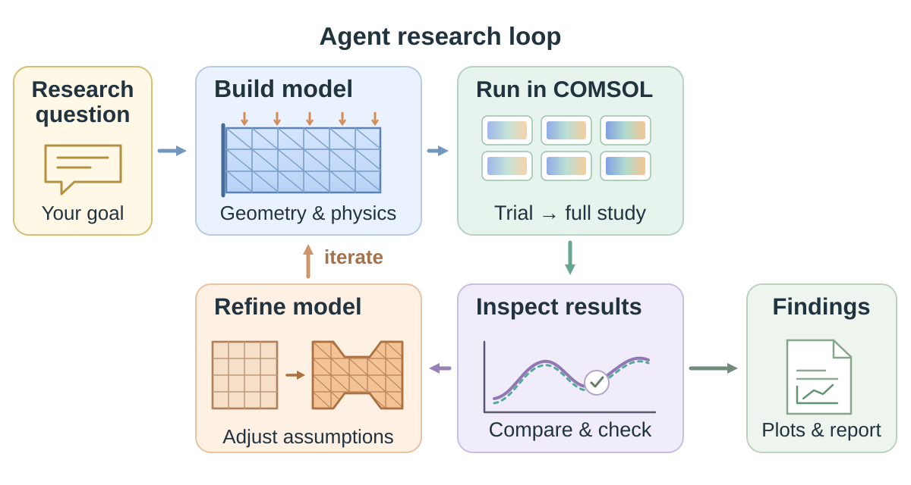

# COMSOL Agent Research Workflow

[English](README.md) · [Agent Skill](skills/comsol-agent-research-workflow/SKILL.md) · [运行示例](examples/edge-current/README.md)

**让 AI Agent 参与 COMSOL 建模、仿真与科研分析。**

将物理假设、Java API 模型代码、批量计算和结果解释连接成一套实际工作流程。仓库提供可安装的 Skill、一个小型可运行示例，以及将模型选择与计算结果保持清晰关联的方法。



## 工作流能帮助完成什么

- **理解并建立模型。** 从研究问题或已有模型出发，明确几何、材料、源项、边界条件和需要观察的量。
- **围绕问题组织计算。** 使用 COMSOL 原生 Java API 和命令行工具，先完成小规模计算，再开展参数扫描或批量任务。
- **形成有依据的结果解释。** 比较控制变量，查看场分布和电极读数，将结论与模型假设、导出数据联系起来。

Skill 为现有的编程 Agent 提供工作方法，数值求解由 COMSOL 完成。使用者可以在过程中继续讨论、检查和调整任务。

## 一次任务怎样推进

| 阶段 | 主要工作 | 可得到的内容 |
|---|---|---|
| 明确问题 | 确定研究问题、假设和观察量 | 简明的模型条件说明 |
| 建模 | 建立或检查几何、选择集、物理场与求解设置 | Java 模型代码，以及需要保存的模型 |
| 计算 | 试算代表工况，再组织所需任务 | 结果、进度和日志 |
| 分析 | 比较不同工况，进行与物理问题相关的检查 | 图表与差异解释 |
| 解释 | 回答最初的研究问题 | 范围清楚、容易阅读的结果报告 |

具体任务可以调整步骤。简单参数修改不需要重新写一份研究计划；接手不熟悉的模型时，通常先检查模型再修改。

## 从 Agent Skill 开始

将完整的 [`skills/comsol-agent-research-workflow`](skills/comsol-agent-research-workflow) 文件夹复制到所用 Agent 支持的 Skill 目录。Codex 的项目级位置可使用 `.agents/skills/comsol-agent-research-workflow/`，其他发现位置见[官方说明](https://learn.chatgpt.com/docs/build-skills)。

例如，将本仓库中的 Skill 文件夹复制到研究项目的 `.agents/skills/` 下。如果还要运行示例，请保留仓库副本。已有同名 Skill 时，先检查差异再替换。

随后向 Agent 提出任务：

```text
使用 $comsol-agent-research-workflow 检查这个 COMSOL 模型，
解释它的物理场、参数、边界条件和现有输出，
再帮助我规划两种电流源配置的对照计算。
```

也可以从明确的模型条件开始：

```text
使用 $comsol-agent-research-workflow，依据这些尺寸与边界条件
建立二维导电模型。先计算一个代表工况，再导出电势和电极电流。
```

这些是提供给 Agent 的任务提示，本身不是执行求解器的命令。

## 执行方式与环境

采用 **Java 模型代码 → COMSOL 批处理 → 数据导出与分析** 的原生路径，Python 可辅助组织任务和输出，无需另外部署 MCP 服务。

需要能够读写文件和执行命令的本地编程 Agent、具备对应物理模块许可的 COMSOL，以及其 Java 和命令行工具。示例使用 Python 3.10+ 和标准库，具体命令与依赖在示例说明中列出。

当前示例基于 **Windows 与 COMSOL 6.4.0.293** 开发。其他版本、操作系统或物理接口需要在对应环境检查。工作流可以指导示例之外的任务，首版实际提供并验证的具体实现是仓库中的这个示例。

官方参考：[COMSOL API](https://doc.comsol.com/6.4/doc/com.comsol.help.comsol/comsol_api_intro.46.02.html) · [批处理与参数扫描](https://www.comsol.com/support/knowledgebase/1250)。

## 一个小型应用示例

[**局域电流源与电极响应**](examples/edge-current/README.md) 在十字形导电薄片中展示模型构建、小规模执行和空间响应分析，并依据 Ma 等人2019年的模型思路，对比固定方向与边缘法向电流源。

它是工作流的一项应用。示例内部说明源项假设、近似几何、运行命令和主要空间响应特征，并注明论文来源。使用的数据由独立演示模型生成，源强采用说明性尺度，没有拟合实验电流。

## 内容入口

| 位置 | 内容 |
|---|---|
| [`skills/`](skills/comsol-agent-research-workflow/) | Agent 规则与按需阅读的参考说明 |
| [`scripts/`](scripts/) | 配套示例启动脚本 |
| [`examples/edge-current/`](examples/edge-current/) | 模型源码、运行方法、结果示意与来源 |
| [`assets/workflow.svg`](assets/workflow.svg) | 可编辑的工作流示意图 |

## 项目状态

首版检查及范围见[验证说明](VALIDATION.md)。

这是一个范围收敛的首版。后续会根据使用情况调整规则、文案和组织方式。重要模型应保留副本，并结合具体物理假设检查生成的修改与结果。

## 许可证

[MIT](LICENSE)。COMSOL 软件及其文档属于独立产品，不随仓库分发。本项目独立维护，来源说明见 [NOTICE](NOTICE.md)。
