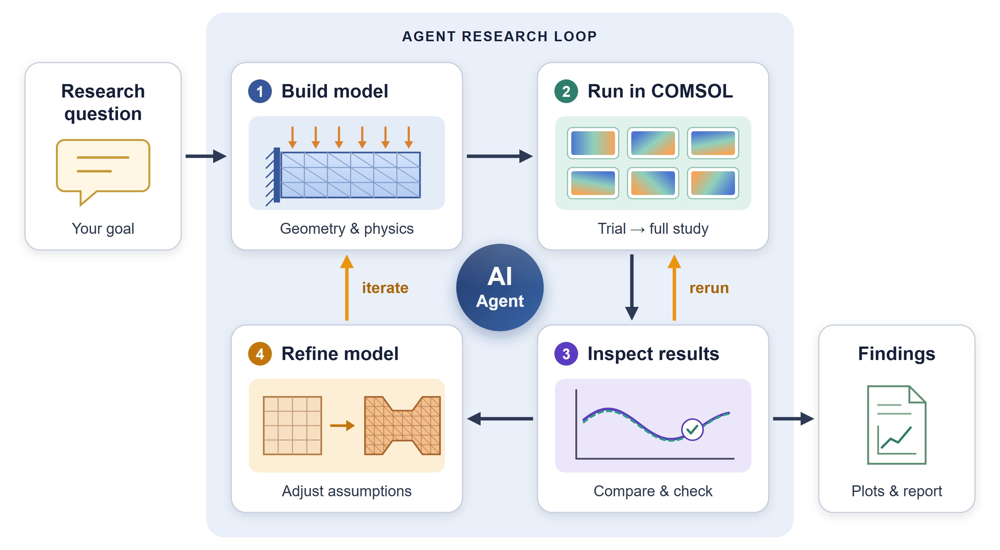
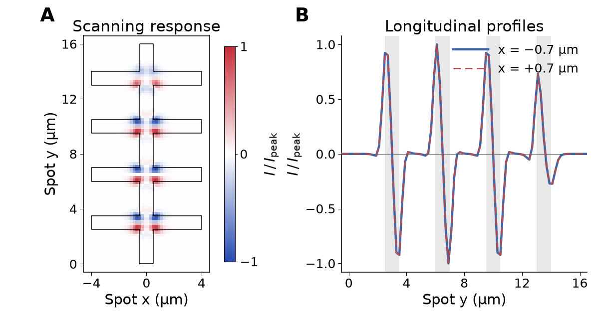

# COMSOL Agent Research Workflow

[English](README.md) | **简体中文**

一个让编程 Agent 通过原生 Java API 与命令行建立、运行并核验 COMSOL Multiphysics 仿真的 Skill，无需 MCP 服务。核验贯穿整个流程：

- 建立或修改模型前，先明确观测量、边界条件和假设。
- 用代表性试算确定全面计算的规模；中断的扫描可从断点续算。
- 解释结果前，检查守恒、极限情形和网格敏感性。
- 数值完成、物理自洽与实验吻合分开报告。

> [!IMPORTANT]
> **Human-in-the-Loop.** Agent 可能产生幻觉、偏离目标，或追逐无关的数字。把每份报告当作草稿：核对细节和背后的计算，留意 Agent 的工作过程，由研究者纠正并决定下一步。



## 示例：边缘电流的收集

采用 Ma 等人提出的边缘电流源与收集模型 [1]，在独立重建的四十字导电结构中应用这套工作流。计算得到的左右对应肩部热点同号，沿沟道经过下、上肩部时，响应呈现重复的正负变化。



**图 1。** **(a)** 底部电极电流随光斑位置的变化。**(b)** x = ±0.7 µm 处的纵向扫描剖面，灰色区域表示横臂所在范围。两图均用完整扫描的最大绝对电流归一化。几何为近似重建，源强用于演示；本例进行定性对照，未标定实验电流。

**[1]** Ma, Q. et al. *Giant intrinsic photoresponse in pristine graphene.* **Nature Nanotechnology 14**, 145–150 (2019). [doi:10.1038/s41565-018-0323-8](https://doi.org/10.1038/s41565-018-0323-8)。

[示例方法、数据与代码 →](examples/edge-current/README.md)

## 开始使用

将完整的 [`comsol-agent-research-workflow`](skills/comsol-agent-research-workflow/) 文件夹复制到 Agent 的 Skill 目录，然后提出任务：

```text
使用 $comsol-agent-research-workflow 检查这个模型，
规划一组对照计算，先运行代表工况，再解释结果。
```

**[安装与使用说明 →](docs/getting-started.md)**

需要可执行本地命令的编程 Agent 和具有许可的 COMSOL。采用原生 Java API 与命令行，无需额外 MCP 服务。配套示例已在 Windows、COMSOL 6.4.0.293 下检查。[验证详情](VALIDATION.md)。

[MIT 许可证](LICENSE) · [来源说明](NOTICE.md)
