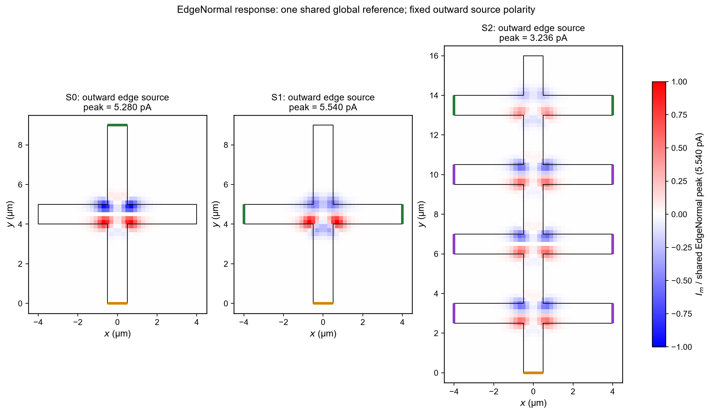
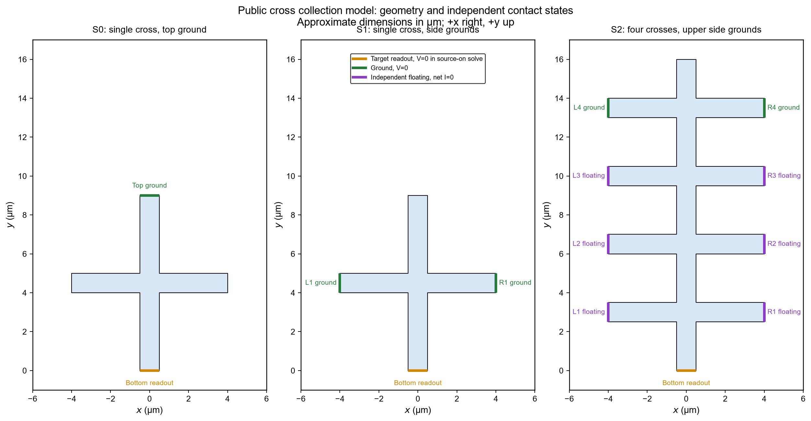

# Edge-current collection in a cross-shaped conductor

This small example demonstrates a complete task within the research workflow: construct a model through the COMSOL Java API, calculate a scan response, export numerical results, and compare selected direct solutions with an auxiliary-field calculation.

The model is independently rebuilt from the public collection model in Ma et al., *Giant intrinsic photoresponse in pristine graphene*, **Nature Nanotechnology 14**, 145–150 (2019), [DOI: 10.1038/s41565-018-0323-8](https://doi.org/10.1038/s41565-018-0323-8). The relevant sources are Figs. 2–3 and Supplementary Sections S4.3–S4.4. The geometry is approximate; this is a qualitative example, rather than a quantitative reconstruction of the authors' device.

## What is calculated?

Each scan pixel is the **total bottom-electrode current when the illumination spot is at that position**. It is not a map of the local current vector. A Gaussian spot excites a prescribed source in the conductor; the geometry and electrical contacts determine how that source contributes to the electrode reading.



The supplied historical calculation shows paired left/right shoulder hotspots with the same sign, with positive and negative hotspots recurring along the four-cross channel. The three panels share one reference current, approximately 5.540 pA. Source amplitude is an arbitrary demonstration scale, so these pA values are **not predictions of experimental photocurrent**. These results were produced before the portable launcher was prepared; a new smoke run does not regenerate this figure.

## Run a small check

Requirements: a licensed COMSOL Multiphysics installation with Electric Currents and batch execution available, plus Python 3.10 or newer. The launcher uses only Python's standard library. The prepared installation layout is COMSOL 6.4 on Windows; a COMSOL installation and license are not included.

Run from the repository root, replacing the installation path with your own:

```powershell
python scripts/comsol-run.py --help

python scripts/comsol-run.py --comsol-home "C:/Program Files/COMSOL/COMSOL64/Multiphysics" --geometry S0 --smoke --dry-run

python scripts/comsol-run.py --comsol-home "C:/Program Files/COMSOL/COMSOL64/Multiphysics" --geometry S0 --smoke
```

`--dry-run` checks paths and prints the commands without creating a run directory or starting COMSOL. `--smoke` performs one auxiliary solve, two source-on direct solves, and four isolated scan samples. **It verifies this short execution path; four samples cannot establish the spatial hotspot pattern.**

Every execution creates a new directory under `runs/edge-current/`. Use `--output <new-directory>` to choose another location. Existing destinations are rejected. The launcher constructs the model from Java source and never takes an existing MPH file as input.

## Generate a full example scan

Omit `--smoke` and select one geometry:

```powershell
python scripts/comsol-run.py --comsol-home "C:/Program Files/COMSOL/COMSOL64/Multiphysics" --geometry S0
```

| Geometry | Shape and contacts | Direct edge-normal points | Scan positions |
|---|---|---:|---:|
| S0 | Single cross; bottom readout, top grounded | 6 | 2,346 |
| S1 | Same shape; bottom readout, left/right arm ends grounded | 6 | 2,346 |
| S2 | Four crosses; bottom readout, upper side pair grounded, six other side contacts independently floating | 8 | 3,956 |

The scan uses the auxiliary-field integral for three source definitions. Direct source-on checks are limited to the edge-normal source. A full S0 or S1 run has seven steady solves; S2 has nine. The many scan integrations are additional work and can take substantially longer than a smoke check.



A new run contains:

```text
run.json                    settings, commands, status, source hash
build/                      run-local Java entry point and compiled classes
logs/                       compiler and COMSOL output
models/<geometry>_weighting.mph
data/scan.csv               three source responses and two fixed-direction components
data/probe-kernels.csv      auxiliary integrals at direct-check positions
data/direct-points.csv      currents, potentials, and independently integrated contact fluxes
data/<geometry>_fields_COMSOL.csv
data/audit.json             source-specific representative-point checks
```

The saved MPH contains the source-off auxiliary solution, not a full collection of source-on scan solutions. The launcher is specific to this example; it does not accept arbitrary COMSOL models.

For an optional plot of a **full** scan:

```powershell
python -m pip install -r requirements.txt
python examples/edge-current/plot.py --run "<run-directory>"
```

Plotting requires Matplotlib and NumPy. These packages are not needed to compile, solve, export, or audit the model.

## Model definition

The conductor is described by a linear, isotropic sheet model:

$$\nabla\cdot\mathbf j=0,\qquad \mathbf j=-g\nabla V+\mathbf q_s.$$

Here, $g=10^{-4}\,\mathrm S$ is sheet conductance; $\mathbf j$ and $\mathbf q_s$ are sheet-current densities in A/m. The two-dimensional Electric Currents implementation uses an effective thickness $d=1$ nm, volume conductivity $g/d$, and volume source $\mathbf q_s/d$. This thickness is a conversion parameter, not a claim about graphene's physical thickness.

| Quantity | Definition |
|---|---|
| Spot | $G=\exp[-2|\mathbf r-\mathbf r_0|^2/w^2]$, $w=0.5$ µm; 1/e² intensity diameter 1 µm |
| Source amplitude | $q_0=0.01$ A/m, not calibrated to experiment |
| BulkFixed | $q_0G(1,1)/\sqrt2$ throughout the conductor |
| EdgeFixed | Same fixed direction, restricted to a 100 nm inner edge strip |
| EdgeNormal | Same edge strip, with the source following the local outward edge normal |
| Actual measurement | Fixed electrodes at 0 V; outward bottom-contact current is positive |
| Auxiliary problem | Source off; bottom at 1 V, grounded electrodes at 0 V |

The auxiliary potential is normalized as $\psi=V_w/(1\,\mathrm V)$, with $\mathbf K=\nabla\psi$. The predicted measurement is $I_m=\int\mathbf q_s\cdot\mathbf K\,dA$. The auxiliary 1 V is a mathematical construction, not an applied photomeasurement bias. The fixed current convention is `Im = -ec.I0_1`, checked against an independent outward contact-flux integral.

Free boundaries satisfy **total-current insulation**, $\mathbf n\cdot\mathbf j=0$. An outward prescribed source therefore does not mean that net current leaves through an insulated boundary. Each floating contact is independently equipotential with zero net current in both actual and auxiliary problems.

S0 and S1 exclude the same four candidate contact faces from the edge-source support, so their source masks remain identical when the grounding changes. S2 uses its own contact layout. At corners, the outward normal is extended from the nearest finite edge segment; equal-distance ties are handled with a mirror-consistent bisector. Overlapping strip regions do not receive duplicate sources.

## What the checks establish

The launcher compares source-on direct results and auxiliary integrals at representative points. It also checks contact-current conservation, independent contact fluxes, floating-contact fluxes in S2, and integration orders 6 versus 10. Every error uses **EdgeNormal's own representative-point peak**, with a 1% peak floor for local relative errors. Failure preserves the output and returns a nonzero status; a zero COMSOL exit code alone is not accepted as success.

The [supplied result summary](data/historical-summary.json) and [representative data](data/representative-points.csv) document the earlier calculation. Its largest edge-normal direct/integral difference was about 0.241% across S0–S2. S0 alone had a separate mesh-refinement comparison, with a maximum representative-point change of about 0.641%. The portable launcher does not rerun that refinement study; S1 and S2 have no separate mesh-refinement study here.

This example addresses spatial response under a prescribed source. It does not simulate charge-neutrality, temperature dependence, carrier-scattering dynamics, or the microscopic origin of the source, and does not establish the paper's microscopic interpretation.
